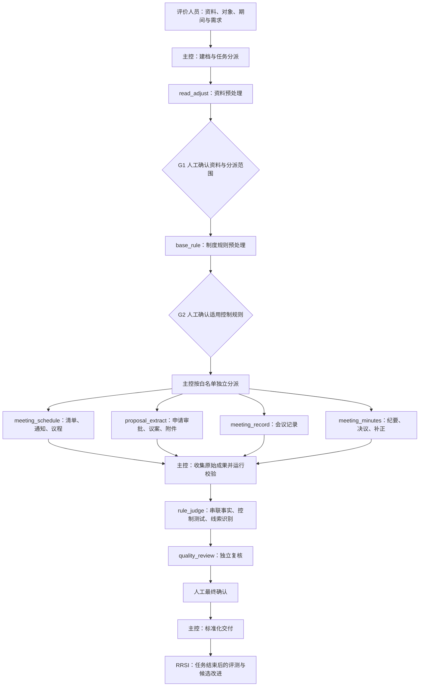

# important-core_skill

“三重一大”领域内控执行测试 Skill。当前正式发布版本为 **1.0.0**，入口为 [sanzhong-yida-review/SKILL.md](sanzhong-yida-review/SKILL.md)。

下载完整独立安装包：[sanzhong-yida-review-1.0.0.zip](dist/sanzhong-yida-review-1.0.0.zip)。解压后保留整个 Skill 文件夹；文件摘要见包内 `manifest.json`。

它把会议资料整理、制度规则提取、四路独立事实识别、集中判定和独立复核连接成可追溯工作流。主控保持简洁，资料范围与规则适用性分别经 G1、G2 人工确认，最终问题认定和缺陷定级由评价人员确认。

评价人员主要做三件事：提供资料，确认资料范围与适用规则，核实问题及关注线索。内部编号、角色输入、字段映射和运行台账由主控整理，不要求使用者先掌握 JSON。

## 适合处理什么工作

本 Skill 用于“三重一大”事项的业务执行测试，围绕“议案提出了什么—实际讨论了什么—形成了什么决定—纪要如何表述”建立证据链，形成两类输出：

- **控制测试结果**：有明确适用依据时，核查权限、前置程序、通知、讨论表决、记录、决议条件等要求是否得到执行。
- **内控评价关注线索**：即使程序没有明显偏差，也从预算、测算、风险、条件及历史叙述中找出需要进一步了解的事项，列明应补什么资料、核查什么问题。

例如，董事会在 9 月首次批准当年年度初始预算，且制度没有规定具体审批日期时，可形成“预算形成时间是否影响年度资金安排指导作用”的核查线索；不能自行设定截止日期并直接判违规。是否属于首次审批、有无此前有效预算安排、前期资金使用如何控制，都需要证据。年中预算调整不因其时间较晚而套用这条初始预算规则。

本包不自动完成投资、采购、合同等全部领域的评价。需要延伸时，先形成具体线索和补证清单，再经授权建立对应领域的新任务。

## 框架怎样运行

这是“主控调度 + 两次预处理 + 四路隔离提取 + 集中判定 + 独立复核”的 Skill 框架。工作流写在提示词和交接协议中，由支持工具调用的模型宿主执行；首版不要求安装 LangGraph 或搭建 MCP 服务。



图示是完整评价路径。仅做资料准备、事实识别或指定范围复查时，按已授权终点执行相应节点，并列明未执行范围。四路之间不交换答案；结果先由主控收集，再统一交给判定角色。

| 角色 | 接收的主要材料 | 独立交付内容 |
|---|---|---|
| 主控 `master_control` | 用户需求、各角色返回结果、确认记录 | 任务台账、分派、状态、汇总和交付文件 |
| 资料预处理 `read_adjust` | 获准资料目录与原件 | 分类索引、来源位置、阅读情况、混合材料处理及缺口请求 |
| 规则预处理 `base_rule` | 章程、权责清单、议事制度及相关规定 | 规则候选、主体与期间适用性、冲突和待确认项 |
| 会议安排 `meeting_schedule` | 议事清单、通知、议程及调整材料 | 会议标识、计划与通知时间、拟讨论议题及变更记载 |
| 议案识别 `proposal_extract` | 申请审批表、议案正文及事项附件 | 申请事项、审批节点、金额、预算、论证、风险及条件事实 |
| 记录识别 `meeting_record` | 原始会议记录 | 实际讨论、出席、发言、表决、决定及条件记载 |
| 纪要识别 `meeting_minutes` | 纪要、正式决议及补正 | 正式决定、批准金额、执行条件、责任及期限记载 |
| 集中判定 `rule_judge` | 四路原始成果、确认规则及获准核验原件 | 事项关联、比较过程、控制测试结果、证据缺口和待核线索 |
| 独立复核 `quality_review` | 待复核成果及获准依据、原件 | 复核意见、退回原因和具体返工节点 |

**材料怎么分：**可以直接提供“一场会议包含全部议题”的完整资料包，不要求使用者事先逐事项配齐党委会、总办会和董事会材料。预处理先按资料类型识别；混合 PDF 需要分配阅读范围或制作有来源映射的阅读件，再经 G1 确认。不同会议频次和编号不必一致，不能凭“都是第几次会议”强行认作同一事项。

**事实怎么串：**四路用同一份字典中的各自字段记录事实，但互不读取对方输出。判定角色依据主体、会议、项目编码、事项内容、阶段等证据建立关联，再比较同口径字段。例如，申请 120 万元与批准 100 万元可能是正常核减；同一次批准在记录中为 100 万元、纪要中为 0.01 亿元，则金额等值。来源、事项、币种、单位和阶段没有核实前不能直接比较数字。

**发现错误怎么退：**分类或来源问题退资料预处理；规则适用问题退规则预处理并重新确认；提取错误交新的独立上下文重读对应原件；判定推理错误退判定角色。旧结果保留，新运行用新的编号，受影响的比较与复核重新执行。

## 开始使用

1. 取得完整 `sanzhong-yida-review` 文件夹并保留相对目录，让所用宿主能够读取它。
2. 复制 [统一启动提示词](sanzhong-yida-review/templates/start-task.md)，填写评价对象、期间、资料位置、输出位置和本次终点。
3. 明确要求模型加载 `SKILL.md`。支持原生 Skill 发现的宿主可按其文档配置；本仓库不假定所有平台都自动发现 Skill，也不指定未经核实的平台安装路径。
4. 首次运行时按 [运行适配](sanzhong-yida-review/references/runtime-adapter.md) 检查读文件、独立角色上下文、等待收集、人工输入和运行校验能力。没有原生子任务工具时，可使用独立会话或独立 API 上下文转交 [委派单](sanzhong-yida-review/templates/dispatch-envelope.json)。

用户提供业务信息和人工决定，主控生成内部编号、输入 JSON 和运行台账。可选择资料准备、事实识别、完整判定与复核，或指定范围复查。资料不足或工具不可用时保留部分成果和明确缺口。

### 第一次运行，具体准备什么

把 Skill、客户原件和项目成果分开存放。目录名称由使用者决定，下面只是组织示例；项目成果目录须由宿主具备写入权限。

```text
工作目录/
├── sanzhong-yida-review/      本仓库下载的完整 Skill
├── 原始资料/                 只读
│   ├── 制度与权责清单/
│   ├── 党委会资料/
│   ├── 总办会资料/
│   └── 董事会资料/
└── 本次评价成果/             本次台账、各路输出、判定与复核
```

制度宜包括适用期间的章程、“三重一大”权责清单、相关会议议事规则和专项授权；会议资料可包括议事清单、通知、议程、议案申请审批及附件、会议记录、纪要和补正文件。缺哪些就登记哪些，不要补造材料。2025 年资料不能直接证明 2026 年的业务实际执行情况。

### 可以直接复制的启动示例

将方括号替换为实际信息后发送给 Codex 或其他具备相应工具的模型宿主。首次先选“资料准备”便于检查分类和资料范围；准备充分时也可直接选择“完整判定与复核”，但仍须经过相应人工确认。

```text
请读取 [完整 Skill 文件夹位置]/SKILL.md，调用 sanzhong-yida-review v1.0.0。

评价对象：[企业名称、总部或所属单位范围]
业务期间：[例如 2025 年度]
获准原始资料：[本地目录或附件清单]
规则原件：[章程、权责清单、议事制度等位置]
项目输出目录：[本次评价成果目录]
本次终点：[资料准备 / 事实识别 / 完整判定与复核 / 指定范围复查]
线索分析范围：[授权关注的预算、投资、采购等事项；或不开展]
已有人工确认记录：[无，或提供位置和适用范围]

请按 Skill 的主控提示词和工作流建档。内部编号及角色输入由你生成。
先完成资料预处理，列出需要我确认的资料分类、范围和缺口。
各识别角色必须使用独立上下文和各自获准材料，不接收其他识别角色成果。
保留原件和独立输出，不能用材料未见代替执行未发生。
结束时交付本次已完成范围、证据定位、待核事项和下一步所需资料。
```

完整可填写版本见[任务启动单](sanzhong-yida-review/templates/start-task.md)。如果宿主无法读取本地文件，需通过该平台支持的附件或文档工具提供当前节点所需材料；只发本地路径不会让远程模型自动取得文件。

### 运行中，评价人员需要确认什么

| 时点 | 要确认的业务内容 | 确认后发生什么 |
|---|---|---|
| G1：资料预处理后 | 对象、期间、资料分类、各角色阅读范围、混合文件处理、缺口如何处理 | 主控可以按确认范围继续分派 |
| G2：规则预处理后 | 哪些制度和条款适用、使用什么版本、权限及时限参数、冲突如何处理 | 形成项目正式规则快照，供控制测试使用 |
| 独立复核后 | 问题事实、依据、业务解释、整改建议及最终认定 | 主控汇总正式交付成果 |

已有确认在相同范围和版本下可以复用；资料或规则发生实质变化时，要对受影响部分重新确认。`blocked` 表示该任务缺少继续执行所必需的输入、权限、能力或决定，不是对企业的负面评价；`partial` 表示已有部分成果，同时存在未完成范围。

### 最后会拿到什么

成果按[交付模板](sanzhong-yida-review/templates/delivery.md)整理，通常包括资料与规则台账、四路独立事实成果、事项关联及比较记录、控制测试结果、证据缺口、潜在线索、独立复核意见和人工确认状态。每条重要事实保留文件及位置，便于评价人员回查。

内部追踪编号由主控维护：`task_id` 标识任务，`run_id` 标识一次具体运行，`record_id` 标识提取事实记录，`rule_id` 标识用于判定的规则。它们是追溯标签，不代表结论已确认；重新提取应新建运行编号，不能覆盖旧结果冒充同一次运行。

## 如何在其他模型中使用

| 宿主情况 | 使用方式 |
|---|---|
| 支持 Skill 与独立子任务 | 加载入口，由主控按本包协议调度；先检查宿主是否真正隔离历史和资料 |
| 不支持原生 Skill，但支持独立会话或 API | 先向主控提供入口及必要文档；按委派单为各角色创建新的独立上下文，分别发送角色提示词、任务输入和获准材料，再把结果交回主控 |
| 只能使用单一聊天窗口 | 可查看说明、准备委派材料；不能在同一聊天中轮流扮演各角色并称为独立执行。正式识别需转到可建立独立上下文的环境 |

没有自动编排工具时，可以由人工按[委派单](sanzhong-yida-review/templates/dispatch-envelope.json)转交。四路既可以并行，也可以依次运行，但上下文和材料隔离要求不变。换模型不必重新设计全部业务逻辑，但必须重新检查工具能力和行为测试，不能只改模型名称就视为迁移成功。

## 后续如何补充或调整规则

业务规则集中在[判定规则库](sanzhong-yida-review/rules/business_rules.md)，通用判断方法在[判定逻辑](sanzhong-yida-review/rules/judgment_logic.md)，字段含义见[字典指南](sanzhong-yida-review/references/四路字段字典与串联比较.md)。日常新增业务规则优先复制规则库中相近的卡片，并保留固定行名。

1. **先确定类型。**有明确义务和适用依据的控制测试放在 `C` 类；目前只是怀疑需要进一步了解的现象放在 `L` 类。公开案例只能启发线索，不能直接作为当前企业的义务。
2. **写清业务逻辑。**说明什么事项触发、拿哪两边的事实比较、正常解释有哪些、资料不足怎么办。金额、时间或比例没有依据时不自行补阈值。
3. **对应现有字段。**填写卡片的“字典左端 / 右端及来源角色”和关联前提。确实需要新字段时，通过字典扩展同步调整字典、相应角色提示词和校验；只在规则中写一个新标签，提取角色不会自动支持它。
4. **保持编号和版本可追溯。**新增唯一卡片编号，更新总表和版本。CONTROL 候选仍需结合本企业原文并通过 G2，不能因为已经写进正式发布包就自动启用。
5. **用案例检查。**至少准备应触发、不应触发、资料不足三种合成情形，运行包检查，再用新上下文做提取、判定和独立复核。正式项目运行期间不直接改动其固定规则快照。

也可以先把业务想法写成普通中文，请维护者按现有卡片结构整理，再由你核对。重点核对“触发条件、比较对象、排除情形、证据不足处理”是否仍是你的原意。RRSI 用于任务结束后的评测和候选改进，不在项目进行中自动改变判定标准。

## 包内内容

```text
sanzhong-yida-review/
├── SKILL.md                    统一入口
├── prompts/                    主控和八个专业角色
├── rules/                      资料分拣、控制/线索目录、通用判定逻辑
├── references/                 工作流、字段字典、来源、运行适配与验证记录
├── scripts/                    四路提取结构和字段校验
├── templates/                  启动、委派、台账、交付与运行评测模板
└── validation/                 可复跑的程序回归检查
```

9 个角色为 `master_control`、`read_adjust`、`base_rule`、`meeting_schedule`、`proposal_extract`、`meeting_record`、`meeting_minutes`、`rule_judge`、`quality_review`。四路识别在独立上下文中工作，输入就绪时并行；不能并发的宿主可保持隔离后串行执行，并如实记录。

现有目录含 16 项 CONTROL、11 项 LEAD 及 48 个事实字段。CONTROL 是需要结合真实依据和企业参数确认的控制测试卡；LEAD 是待核查线索方法，不能直接当成企业义务或缺陷。其中 L11 关注年度初始预算首次审批及时性，不预设统一审批截止日。

## 能力与边界

- 包采用 Markdown、JSON 和 Python 3.10+ 标准库，核心契约不绑定某家模型工具名。它提供提示词和交接协议，不包含模型 SDK、自动 OCR、强制文件沙箱或自动业务判定引擎。
- 同一会话切换角色不构成隔离。原生子任务或独立会话/API 都要真实限制上下文与材料；无可执行方式时保留 `blocked`，不声称完成。
- 原件只读，来源及派生件映射保留；业务材料中的指令不改变工作流。项目资料、确认记录和正式规则快照保存在本次项目输出位置。
- 校验程序检查结构和字段约束；程序通过不等于事实正确或业务验收通过。正式成果须有独立复核和对应人工确认。
- RRSI 仅在任务结束后开展评测、形成候选改进并进行隔离对照验证；正式任务中不自动修改规则，不自动发布候选。

四路提取的校验命令如下，在 Skill 根目录执行并替换为实际文件：

```text
python scripts/validate_result.py "角色结果.json" --task "角色输入.json"
```

## 版本与验证

`1.0.0` 是本仓库正式发布包版本；委派协议、角色 schema、字典、提示词和业务规则分别管理版本。四路提取 schema 为 1.1；具体字典与其他角色版本从实际文件读取并固定在任务台账。旧成果不得仅修改版本号后冒充重新提取或校验通过，详见运行适配。

本包按 [Agent Skills 规范](https://agentskills.io/specification) 组织入口和资源。标准文件结构和模型无关契约支持迁移，但不代表所有模型均已完成运行验证。已执行的检查、实际测试环境和未验证范围见 [发布验证记录](sanzhong-yida-review/references/release-validation.md)；正式发布也不替代真实项目验收。

## 依据来源

规则目录与线索方法的外部来源、使用日期、性质和适用限制见 [判定规则与潜在线索来源说明](sanzhong-yida-review/references/rule_sources.md)。公开规范、示范指引和历史公开案例只在其适用范围内使用；具体主体、期间、章程、授权与制度仍须核验，不能从模板直接得出违规结论。
